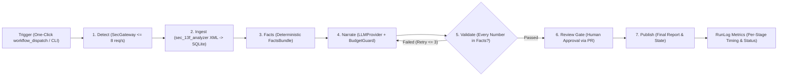

# sec_13f_autopilot

> **Human-approved, one-click pipeline; scheduled mode optional.**
>
> *Disclaimer: Not investment advice; AI-drafted, figures checked against filings data.*

`sec_13f_autopilot` automates quarterly SEC Form 13F-HR / 13F-HR/A updates on top of the [`sec_13f_analyzer`](https://github.com/kamal-hq/sec_13f_analyzer) library. It detects new institutional filings on SEC EDGAR, ingests and reconciles holdings into the star-schema SQLite database, computes deterministic Smart Money Convergence facts, drafts a markdown research note under strict budget and fact-checking guards, and pauses at a mandatory **human review gate (via Pull Request)** before publishing.

---

## Purpose & Framing

Quarterly 13F filings arrive in bursts around the 45-day SEC reporting deadline. Rather than claiming "fully autonomous unattended publishing", `sec_13f_autopilot` is designed as a **human-approved, one-click pipeline** (with optional scheduled mode):

1. **Deterministic Quantitative Core**: All holdings parsing, CUSIP/sector mapping, stock-split adjustments, and Smart Money Convergence calculations are performed deterministically via `sec_13f_analyzer`.
2. **Evidence-Bound Narrative**: The LLM (`GeminiProvider`), human-in-the-loop file exchange (`ManualProvider`), or deterministic template (`NullProvider`) only summarizes pre-computed figures from `FactsBundle`.
3. **Fact Validation Loop**: `ValidateStage` checks every number in the draft against `FactsBundle.allowed_numbers`, retrying narrative generation up to **3 times** before failing closed.
4. **Mandatory Human Review Gate**: No report is published until a human reviewer inspects the diff and approves the Pull Request / staged artifact.

---

## Architecture Diagram



---

## Installation & Setup

### Prerequisites
- Python **3.11+**
- Local sibling checkout of `sec_13f_analyzer` for development (`../sec_13f_analyzer`), or pinned tag `v1.1.0` in CI.

### Local Development
```bash
# 1. Install sec_13f_analyzer in editable mode (once packaged)
pip install -e ../sec_13f_analyzer

# 2. Install sec_13f_autopilot with dev dependencies
pip install -e ".[dev]"

# 3. Copy .env.example to .env and populate SEC_USER_AGENT
cp .env.example .env

# 4. Install pre-commit hooks (ruff + gitleaks)
pre-commit install
```

### CI Installation
In GitHub Actions (`.github/workflows/ci.yml` and `.github/workflows/autopilot.yml`), `sec_13f_analyzer` is installed from its pinned git tag `v1.1.0`:
```bash
pip install "git+https://github.com/kamal-hq/sec_13f_analyzer.git@v1.1.0"
pip install -e .
```

---

## Usage

### Phase 1, 2, 3a & 3b: Detection, Ingestion, Facts, Narration, and Validation

```bash
# Detect 13F-HR and 13F-HR/A filings across configured funds (writes reports/<period>/detect.json)
autopilot detect

# Replay detection as of a historical cutoff date (ignores filings with filed_date > as-of)
autopilot detect --as-of 2026-08-20
autopilot detect --as-of 2026-09-05

# Dry-run detection (no report files written)
autopilot detect --as-of 2026-09-05 --dry-run

# Ingest target period and lookback periods into data/autopilot.db and reconcile against cover pages
autopilot ingest --period 2026-Q2

# Extract deterministic facts, diff markdown, and allowed numbers bundle (reports/<period>/facts.json)
autopilot facts --period 2026-Q2

# Generate deterministic research note draft with NullProvider (reports/<period>/draft.md & draft_clean.md)
autopilot narrate --period 2026-Q2 --llm none

# Generate draft with Gemini narrative and automated retry loop (max 3 attempts)
autopilot narrate --period 2026-Q2 --llm gemini --max-attempts 3

# Generate draft using human-in-the-loop manual file exchange
autopilot narrate --period 2026-Q2 --llm manual

# Audit draft markdown against facts bundle using deterministic rules R1-R9 (reports/<period>/validation_report.json/.md)
autopilot validate --period 2026-Q2

# Validate a custom draft path
autopilot validate --period 2026-Q2 --draft reports/2026-Q2/draft.md

# Run the pipeline in sequence through a specific stage with LLM narrative
autopilot run --through validate --llm none
autopilot run --through validate --llm gemini --max-attempts 3
autopilot run --through narrate --llm none
autopilot run --through facts --as-of 2026-09-05
```

### Deterministic Validator Rules (R1–R9)

`ValidateStage` (`src/autopilot/stages/validate.py`) executes 100% offline without LLM invocations, auditing the draft against `facts.json`:
- **R1 Number Grounding**: Every figure (currency, percent, count, multiplier) must cite an existing `[fact_id]` and match: equal to a listed display format, or the underlying fact rounded to $k$ significant figures for some $k \ge 2$ (within 2%). Units must agree ($M is not $B).
- **R2 Citation Integrity**: Every cited `[fact_id]` exists in `facts.json`; no orphan tags.
- **R3 Entities**: Tracked institutional funds and ticker symbols in prose must exist in facts for the target period.
- **R4 Entity Binding**: Cited breakdown facts must bind to the entity named in their clause/bullet.
- **R5 Banned Advice**: Predictions and financial advice (`will outperform`, `expected to`, `should buy/invest`, `accumulate`, `alpha`, `guaranteed`) are forbidden outside Limitations. Inside Limitations, they are permitted only in negated form.
- **R6 Causal Claims**: Verbs of cause (`because`, `due to`, `driven by`, `as a result of`) linking market movements to external events are forbidden outside Limitations.
- **R7 Required Content**: All 9 canonical section headings, 6 required `limit.*` facts, and valid period metadata must be present.
- **R8 Stale Superseded Data**: Superseded pre-amendment values (e.g., Citadel's pre-amendment 2026-Q2 total) are rejected.
- **R9 Formatting & Length Guardrails**: Strictly forbids URLs, markdown links (`[text](url)`), HTML tags, and code fences in narrative blocks, and enforces a strict length cap of 150 words per narrative block.

The adversarial suite (`tests/adversarial/cases.yaml`) validates that 20 bad mutations are rejected by their specific rule (R1–R9) and 7 good mutations are accepted cleanly (`bad rejected 20/20, good accepted 7/7`). Every rule R1–R9 is exercised by at least one adversarial case.


---

## Verified Parity

Rebuilt from SEC filings in a fresh environment; the database matches the original Project 1 database cell for cell (7 funds, 8,860 securities, 50,311 holdings; all 14 fund-period totals reconcile to SEC cover-page totals to the dollar).

### What the Parity Check Caught (Zero-Value Sinovac Rows)
A naive count filtering on `value_usd > 0` reports 22,851 active Q1 rows, 24,010 active Q2 rows, and 3,446 exited rows (total 50,307 holdings)—which is **4 rows short** of the 50,311 total rows in `Fact_Holdings`.

The parity verification script caught exactly four active holding records filed with `value_usd = 0`:
- **Sinovac Biotech Ltd (`SVA`, CUSIP `P8696W104`)**:
  - CalPERS: 2026-Q1 (68,732 shares, `$0`) and 2026-Q2 (68,732 shares, `$0`, `UNCHANGED`)
  - Renaissance Technologies: 2026-Q1 (1,312,520 shares, `$0`) and 2026-Q2 (1,312,520 shares, `$0`, `UNCHANGED`)

Accounting for these 4 active zero-value rows restores exact mathematical parity:
`22,853 (Q1 active) + 24,012 (Q2 active) + 3,446 (exited) = 50,311 total holdings`.

### Reproducing Database Parity
To verify parity across both databases in read-only mode:

```bash
# Compare local data/autopilot.db against sibling Project 1 database
python scripts/parity_check.py

# Or specify custom paths (skips cleanly with code 0 if sibling DB is absent):
python scripts/parity_check.py --db1 data/autopilot.db --db2 ../sec_13f_analyzer/data/sec_13f.db
```

### Full Pipeline Options

```bash
# Dry-run stage verification (offline, uses NullProvider by default)
autopilot --dry-run

# Run for a specific quarter using deterministic NullProvider
autopilot --period 2026-Q2 --provider null

# Run with ManualProvider (writes reports/2026-Q2/prompt.md and reads response.md)
autopilot --period 2026-Q2 --provider manual

# Run with GeminiProvider (requires GEMINI_API_KEY in environment)
autopilot --period 2026-Q2 --provider gemini
```

---

## Security Posture (Non-Negotiable Invariants)

- **Environment-Only Secrets**: `SEC_USER_AGENT`, `GEMINI_API_KEY`, and `OPENFIGI_API_KEY` are loaded exclusively from environment variables via `Settings`. Supplying secret keys inside `config.yaml` raises a `SettingsError`.
- **Masked Representations**: `Settings.__repr__()` and `Settings.__str__()` always mask secrets with `'***REDACTED***'`.
- **Least-Privilege Key Access**: Only `GeminiProvider` reads the Gemini API key (`settings.read_gemini_api_key()`). `NullProvider` and `ManualProvider` never touch it.
- **Redacted Logging**: `SecretRedactionFilter` scrubs literal secret values as well as `key=...`, `api_key=...`, `Authorization: Bearer ...`, and Google API key (`AIza...`) patterns from all log records. Request/response bodies are **never** logged—only HTTP/LLM status codes and token counts.
- **LLM Budget & Kill Switch**: `BudgetGuard` enforces `max_calls_per_run` (default `5`), `max_output_tokens`, per-call timeouts, and an immediate environment kill switch (`AUTOPILOT_LLM_DISABLED=1`).
- **Hardened GitHub Workflows**:
  - Default `permissions: contents: read`
  - **No** `pull_request` or `pull_request_target` triggers
  - All actions pinned to full 40-character commit SHAs
  - `autopilot.yml` triggers via `workflow_dispatch` only (the `cron` schedule line is commented out with a note regarding GitHub's 60-day repository inactivity rule).
- **Secret Scanning**: `.env` is gitignored, `.env.example` contains placeholders only, and `gitleaks` is enforced via `.pre-commit-config.yaml`.

---

## LLM Modes and Security

`sec_13f_autopilot` supports three operational modes for quarterly research note narrative generation:

| Mode | Provider | Key Required | Description |
| :--- | :--- | :---: | :--- |
| `none` / `null` | `NullProvider` | No | 100% deterministic template generation. Zero API tokens or external calls. Footer: *"Generated deterministically from filings data; not investment advice."* |
| `manual` | `ManualProvider` | No | Human-in-the-loop file exchange. Generates `reports/<period>/prompt.md`, awaits `reports/<period>/response.md`. If validation fails, outputs `reports/<period>/repair_prompt.md`. |
| `gemini` | `GeminiProvider` | Yes (`GEMINI_API_KEY`) | Official Google GenAI SDK with automated retry loop (up to `--max-attempts 3`). On validation failure, builds targeted repair prompts. Falls back cleanly to deterministic draft on quota exhaustion (HTTP 429) or persistent defects. |

### Security Invariants for LLM Narratives
1. **API Keys from Environment Only**: `GEMINI_API_KEY` is loaded exclusively from environment variables via `Settings.read_gemini_api_key()`. It is never stored in `config.yaml`, fixtures, or logs.
2. **Free-Tier Data Hygiene**: Prompts sent to Gemini contain ONLY a compact, pre-computed fact sheet of public quantitative facts (`id | label | display`). Prompts contain **zero** local file paths, **zero** environment variable names or credentials, and **zero** raw SEC filing XML text.
3. **Guarded Budget**: `BudgetGuard` caps calls per run (default `5`), output tokens, per-request timeouts, and provides an immediate kill switch via `AUTOPILOT_LLM_DISABLED=1`.
4. **Offline Test Suite & Live Smoke Test**:
   - The test suite (`pytest`) runs 100% offline with zero network calls and mocked/fake providers.
   - An optional live smoke test (`tests/live/test_gemini_smoke.py`) is marked `@pytest.mark.live` and skipped by default. Operators can manually execute it in an isolated terminal session with a real key:
     ```bash
     $env:RUN_LIVE_GEMINI="1"
     $env:GEMINI_API_KEY="your-gemini-api-key"
     pytest tests/live/test_gemini_smoke.py -v
     ```

---

## Quality & Testing

All tests run 100% offline using mocked HTTP sessions and mocked SDK clients:

```bash
ruff check src tests
ruff format --check src tests
pytest
pre-commit run --all-files
```

---

## Disclaimer

**Not investment advice; AI-drafted, figures checked against filings data.**
All data is sourced from public SEC Form 13F filings for informational and educational research only. Form 13F filings reflect long US equity positions as of quarter-end, exclude short positions and non-13F assets, and are filed up to 45 days after quarter close.

---

## License

MIT License. See [LICENSE](LICENSE).
