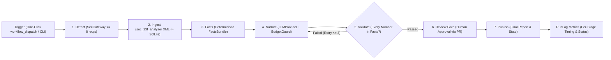

# sec_13f_autopilot

> **Human-approved, one-click pipeline; scheduled mode optional.**
>
> *Disclaimer: Not investment advice; AI-drafted, figures checked against filings data.*

`sec_13f_autopilot` automates quarterly SEC Form 13F-HR / 13F-HR/A updates on top of the [`sec_13f_analyzer`](https://github.com/kamal-hq/sec_13f_analyzer) library. It detects new institutional filings on SEC EDGAR, ingests and reconciles holdings into the star-schema SQLite database, computes deterministic Smart Money Convergence facts, drafts a markdown research note under strict budget and fact-checking guards, and pauses at a mandatory **human review gate (via Pull Request)** before publishing.

---

## Purpose & Framing

Quarterly 13F filings arrive in bursts around the 45-day SEC reporting deadline. Rather than claiming "fully autonomous unattended publishing", `sec_13f_autopilot` is designed as a **human-approved, one-click pipeline** (with optional scheduled mode):

1. **Deterministic Quantitative Core**: All holdings parsing, CUSIP/sector mapping, stock-split adjustments, and Smart Money Convergence calculations are performed deterministically via `sec_13f_analyzer`.
2. **Evidence-Bound Narrative**: The LLM (`GeminiProvider`), human-in-the-loop file exchange (`ManualProvider`), or deterministic template (`NullProvider`) only summarizes pre-computed figures from `FactsBundle`.
3. **Fact Validation Loop**: `ValidateStage` checks every number in the draft against `FactsBundle.allowed_numbers`, retrying narrative generation up to **3 times** before failing closed.
4. **Mandatory Human Review Gate**: No report is published until a human reviewer inspects the diff and approves the Pull Request / staged artifact.

---

## Architecture Diagram



---

## Installation & Setup

### Prerequisites
- Python **3.11+**
- Local sibling checkout of `sec_13f_analyzer` for development (`../sec_13f_analyzer`), or pinned tag `v1.1.0` in CI.

### Local Development
```bash
# 1. Install sec_13f_analyzer in editable mode (once packaged)
pip install -e ../sec_13f_analyzer

# 2. Install sec_13f_autopilot with dev dependencies
pip install -e ".[dev]"

# 3. Copy .env.example to .env and populate SEC_USER_AGENT
cp .env.example .env

# 4. Install pre-commit hooks (ruff + gitleaks)
pre-commit install
```

### CI Installation
In GitHub Actions (`.github/workflows/ci.yml` and `.github/workflows/autopilot.yml`), `sec_13f_analyzer` is installed from its pinned git tag `v1.1.0`:
```bash
pip install "git+https://github.com/kamal-hq/sec_13f_analyzer.git@v1.1.0"
pip install -e .
```

---

## Usage

### Phase 1 & 2: Detection, Ingestion, and Facts Extraction

```bash
# Detect 13F-HR and 13F-HR/A filings across configured funds (writes reports/<period>/detect.json)
autopilot detect

# Replay detection as of a historical cutoff date (ignores filings with filed_date > as-of)
autopilot detect --as-of 2026-08-20
autopilot detect --as-of 2026-09-05

# Dry-run detection (no report files written)
autopilot detect --as-of 2026-09-05 --dry-run

# Ingest target period and lookback periods into data/autopilot.db and reconcile against cover pages
autopilot ingest --period 2026-Q2

# Extract deterministic facts, diff markdown, and allowed numbers bundle (reports/<period>/facts.json)
autopilot facts --period 2026-Q2

# Run the pipeline in sequence through a specific stage (e.g., detect -> ingest -> facts)
autopilot run --through facts
autopilot run --through facts --as-of 2026-09-05
```

### Full Pipeline Options

```bash
# Dry-run stage verification (offline, uses NullProvider by default)
autopilot --dry-run

# Run for a specific quarter using deterministic NullProvider
autopilot --period 2026-Q2 --provider null

# Run with ManualProvider (writes reports/2026-Q2/prompt.md and reads response.md)
autopilot --period 2026-Q2 --provider manual

# Run with GeminiProvider (requires GEMINI_API_KEY in environment)
autopilot --period 2026-Q2 --provider gemini
```

---

## Security Posture (Non-Negotiable Invariants)

- **Environment-Only Secrets**: `SEC_USER_AGENT`, `GEMINI_API_KEY`, and `OPENFIGI_API_KEY` are loaded exclusively from environment variables via `Settings`. Supplying secret keys inside `config.yaml` raises a `SettingsError`.
- **Masked Representations**: `Settings.__repr__()` and `Settings.__str__()` always mask secrets with `'***REDACTED***'`.
- **Least-Privilege Key Access**: Only `GeminiProvider` reads the Gemini API key (`settings.read_gemini_api_key()`). `NullProvider` and `ManualProvider` never touch it.
- **Redacted Logging**: `SecretRedactionFilter` scrubs literal secret values as well as `key=...`, `api_key=...`, `Authorization: Bearer ...`, and Google API key (`AIza...`) patterns from all log records. Request/response bodies are **never** logged—only HTTP/LLM status codes and token counts.
- **LLM Budget & Kill Switch**: `BudgetGuard` enforces `max_calls_per_run` (default `5`), `max_output_tokens`, per-call timeouts, and an immediate environment kill switch (`AUTOPILOT_LLM_DISABLED=1`).
- **Hardened GitHub Workflows**:
  - Default `permissions: contents: read`
  - **No** `pull_request` or `pull_request_target` triggers
  - All actions pinned to full 40-character commit SHAs
  - `autopilot.yml` triggers via `workflow_dispatch` only (the `cron` schedule line is commented out with a note regarding GitHub's 60-day repository inactivity rule).
- **Secret Scanning**: `.env` is gitignored, `.env.example` contains placeholders only, and `gitleaks` is enforced via `.pre-commit-config.yaml`.

---

## Quality & Testing

All tests run 100% offline using mocked HTTP sessions and mocked SDK clients:

```bash
ruff check src tests
ruff format --check src tests
pytest
pre-commit run --all-files
```

---

## Disclaimer

**Not investment advice; AI-drafted, figures checked against filings data.**
All data is sourced from public SEC Form 13F filings for informational and educational research only. Form 13F filings reflect long US equity positions as of quarter-end, exclude short positions and non-13F assets, and are filed up to 45 days after quarter close.

---

## License

MIT License. See [LICENSE](LICENSE).
